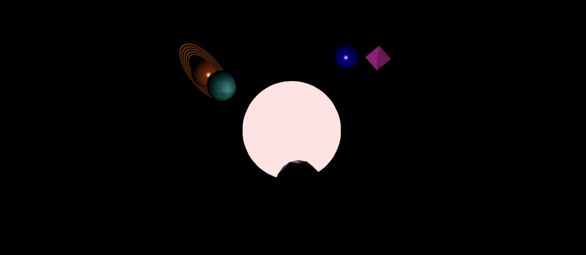

# Advanced Shader and Planetary Animation

An interactive, dynamic solar system with custom shaders, using both Gouraud and Phong shading models. Click keys 0-5 to manipulate camera view and object behavior.

## Goals

1. **Understand Shading Models in Three.js**  
   Grasp the inner workings of **Gouraud** and **Phong** shading models and how to implement them using custom shaders in Three.js.

2. **Create Custom Shaders and Materials in GLSL**  
   Write custom vertex and fragment shaders using GLSL (OpenGL Shading Language) to implement the desired shading effects.

3. **Animate Objects Using Transformation Matrices**  
   Apply translation, rotation, and scaling matrices to animate objects in 3D space over time.

4. **Implement User Interaction via Keyboard Controls**  
   Allow users to interact with the scene by attaching the camera to different planets and toggling between shading models.